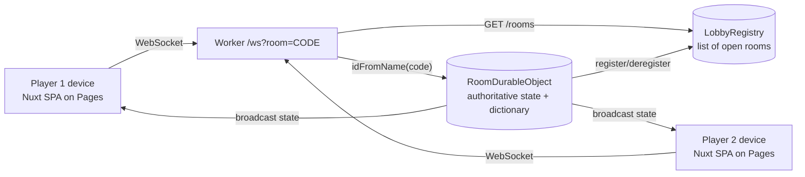

# WordMorph | Versus

A head-to-head word-transformation duel. Players alternate turns mutating a shared
word **one letter at a time** into a new valid English word. Break the chain — an
invalid word, more/fewer than one letter changed, or a repeat — and your rival wins.

Ways to play:

- **Same device (hot seat):** pass-and-play on one screen.
- **Two devices (online):** create a room, share the code/link, or **browse the public
  list of open rooms** and join one in a click. You can **leave a room** anytime before
  the match starts to free the slot.
- **Party (3–10 players):** an online, last-player-standing elimination match. Everyone
  shares one chain; break it and you're **out** (but the game keeps going). Play passes to
  the next survivor in seating order until **one player remains** — they win. A podium at
  the end ranks everyone by finish order.
- **Versus Self (Rush):** a solo challenge — chain as many words as you can and beat your
  best score.

Small niceties:

- **Your name is remembered.** It's saved to `localStorage` (not a cookie — the name is
  purely client-side) whenever you create or join a game, so it survives New Game, going
  back to the mode screen, and page reloads, and pre-fills next time.
- **Mobile-friendly tile input.** Tapping a tile puts the caret at the end of the letter,
  and typing always **replaces** the current letter regardless of where a mobile browser
  drops the caret — so you never get a letter wedged in front of the existing one.
- **Invite links & an open-rooms browser.** Share a `?room=`/`?party=` link for one-tap
  join, or pick from the live list of open rooms/parties (there's no manual code-entry
  box — Refresh the list and click Join).

**Fast-paced rules:** each player has **15 seconds** per turn, and your move is
submitted **the instant you type a letter** — one keystroke locks it in, no take-backs.
Run out of time and you lose. In online mode the clock is enforced by the server
(the Durable Object), so neither side can stall or disagree.

**At game over** the screen tells the full story of the chain: every **failed attempt**
(a broken-chain word, a timeout, or a resign) is shown **in red** with the offending
letter highlighted, and — for any loss except a resign — a **"You could've played"** panel
lists valid single-letter moves the loser missed (with the changed letter highlighted),
so players learn what would have kept the chain alive.

Built with **Nuxt 3 (Vue 3, `ssr: false`)** for the frontend and a **Cloudflare Worker
with a Durable Object** for authoritative real-time multiplayer. Both halves run on the
Cloudflare **free tier**.

## Architecture



- The frontend is a static SPA. In online mode each device opens a WebSocket to the
  Worker at `/ws?room=CODE`.
- The Worker routes each room code to a single **`RoomDurableObject`** instance
  (`env.ROOM.idFromName(code)`) that holds the authoritative game state and the
  dictionary, validates every move, and broadcasts the resulting state to both players.
- **Party mode** is a parallel path: `/party/ws?room=CODE` routes to a
  **`PartyRoomDurableObject`** (`env.PARTY_ROOM.idFromName(code)`), a separate DO class
  that owns the N-player (3–10) elimination state machine. It reuses the same pure
  `gameLogic.mjs` rules but identifies players by a **stable string id** (not a 0/1 index)
  and, on an illegal move / timeout / resign, **eliminates** the offender and passes the
  turn to the next active player — ending only when one survivor remains. The 2-player
  `RoomDurableObject` is left untouched. `/party/new` mints codes and `/party/rooms` lists
  waiting parties (with a `N/10` player count).
- A single **`LobbyRegistry`** Durable Object tracks rooms that are **waiting** for more
  players. Duel rooms register while waiting for a second player; party rooms register
  while waiting to start. `GET /rooms` returns duel listings and `GET /party/rooms`
  returns party listings (the registry tags each entry with a `mode`).
- Clients are thin renderers: they send intents (`join`, `start`, `move`, `rematch`,
  `resign`, `leave`) and render whatever `state` the server broadcasts. **The client
  never decides win/loss** — the server does. The broadcast `state` also carries the
  **failed attempts** (for the red history) and, at game over, the **missed words** the
  server computes from the last board word (valid single-letter neighbors, preferring
  ones not yet played). Hot-seat/solo compute the same two things in-browser since they
  already hold the dictionary.
- The DO uses the **WebSocket Hibernation API**, so it is evicted from memory between
  turns while sockets stay open. Combined with SQLite-backed storage, this keeps the
  game comfortably within the free tier.

Hot-seat mode reuses the original in-browser game logic and needs no backend.

## Project structure

```
word-morph-versus/
├─ app.vue                      # Screen router: mode select / lobbies / board
├─ nuxt.config.ts               # ssr:false, static preset, runtimeConfig.public.wsUrl
├─ tailwind.config.ts
├─ assets/css/main.css
├─ components/
│  ├─ ModeSelect.vue            # Mode grid: same device / online / party / solo
│  ├─ GameLobby.vue             # Hot-seat lobby (names + length)
│  ├─ OnlineLobby.vue           # Create/join 2-player room, invite link, waiting room
│  ├─ PartyLobby.vue            # Create/join party (3–10), roster, N/10, host start
│  ├─ GameBoard.vue             # Turn indicator, tiles, history, party player strip
│  ├─ TileInput.vue             # Per-letter tiles; mobile-safe replace-on-type
│  ├─ WordChainHistory.vue      # Chain log + failed attempts shown in red
│  └─ GameOverDialog.vue        # Winner / party podium + "you could've played"
├─ composables/
│  ├─ useWordMorph.ts           # Hot-seat logic + name persistence (client-authoritative)
│  ├─ useOnlineGame.ts          # 2-player WebSocket client store (server-authoritative)
│  ├─ usePartyGame.ts           # Party (3–10) WebSocket client store (id-based)
│  └─ useGameSession.ts         # Facade exposing ONE interface for all modes
├─ public/words-{4,5,6}.json    # Word lists (client copy; optional for online)
├─ test/                        # Vitest: online store, party store, lobby, turn gating
└─ worker/                      # Cloudflare Worker (separate deploy)
   ├─ src/
   │  ├─ index.ts               # Router: /new, /rooms, /ws, /party/{new,rooms,ws}, CORS
   │  ├─ RoomDurableObject.ts    # Authoritative 2-player state + WS hibernation + alarm
   │  ├─ PartyRoomDurableObject.ts # Authoritative N-player elimination state machine
   │  ├─ LobbyRegistry.ts       # Global registry of open rooms (duel + party)
   │  ├─ protocol.ts            # 2-player duel message protocol
   │  ├─ partyProtocol.ts       # Party (id-based) message protocol
   │  ├─ gameLogic.mjs          # Shared pure rules: validate, neighbors (+ .d.ts types)
   │  └─ words/words-{4,5,6}.json
   ├─ wrangler.toml             # SQLite DO migrations + ROOM, PARTY_ROOM & REGISTRY bindings
   └─ test/                     # node:test unit + WS integration drivers (duel + party)
```

## Local development

You need **two processes**: the Worker and the Nuxt frontend.

```bash
# 1) Install (root + worker)
npm install
cd worker && npm install && cd ..

# 2) Terminal A — run the Worker (Durable Object) locally
cd worker
npx wrangler dev            # serves http://127.0.0.1:8787

# 3) Terminal B — run the frontend
npm run dev                 # serves http://localhost:3000
```

The frontend defaults `runtimeConfig.public.wsUrl` to `http://127.0.0.1:8787`, so online
mode talks to your local Worker out of the box. Open two browser windows (or your phone
on the same network) to play across "devices".

## Tests

```bash
# Frontend (Vitest): stores, lobbies, turn gating, tile input,
# failed-attempt + missed-word tracking, name persistence
npm test

# Worker unit rules (node:test): move validation + neighbor finding
cd worker && npm test

# Worker WebSocket integration — 2-player duel (boots `wrangler dev`)
cd worker && bash test/run-ws-it.sh

# Worker WebSocket integration — party elimination (3+ clients)
cd worker && bash test/run-party-ws-it.sh
```

The duel integration driver verifies the full flow: both players join, server seeds the
start word, valid moves advance the chain and flip turns, out-of-turn moves are
rejected, an illegal move ends the game with the opponent winning (synced to both
clients), the failed word is recorded for the red history, the game-over state lists at
least one playable "missed" word, rematch/resign work, a third joiner is rejected, rooms
are isolated, and a dropped player can rejoin with the same code+name to resume.

The party integration driver boots a multi-client match and verifies elimination
mechanics: three players join in seating order, only the host can start (and only with
≥3 players), an illegal move eliminates just that player (recording the failed word)
while the game continues, the turn skips eliminated players, the last survivor wins with
correct podium placements, `missedWords` is suppressed when the game ends on a resign,
rematch clears eliminations, and late joiners are rejected once the match is underway.

## Deploy (Cloudflare free tier)

The app has **two independently deployed halves**: the **Worker** (backend: Durable
Objects + WebSockets) and the **static frontend** (Cloudflare Pages). Deploy the Worker
first so you have its URL to point the frontend at.

### One-time setup

```bash
npm install -g wrangler        # or just use `npx wrangler ...`
wrangler login                 # opens a browser to authorize your Cloudflare account
wrangler whoami                # confirm the account you're deploying to
```

> **First-time account gotcha:** if your Cloudflare account has never used Workers, the
> first `wrangler deploy` can fail with `You need a workers.dev subdomain` (code 10063).
> Fix it once: open the Cloudflare dashboard → **Workers & Pages**, and (if prompted)
> pick a subdomain. Then re-run the deploy — it goes straight through. Your Worker will
> live at `https://word-morph-worker.<your-subdomain>.workers.dev`.

### 1) Deploy the Worker + Durable Objects

```bash
cd worker
wrangler deploy
```

`wrangler.toml` declares **three SQLite-backed Durable Object migrations**
(`new_sqlite_classes = ["RoomDurableObject"]`, `["LobbyRegistry"]`, and
`["PartyRoomDurableObject"]`). SQLite-backed DOs are required on the free plan (key-value
DOs are paid-only). The deploy output prints your Worker URL — **copy it**, you need it
for the frontend. Verify it's live:

```bash
curl https://word-morph-worker.<your-subdomain>.workers.dev/health
# -> {"ok":true,"service":"word-morph-worker"}
```

> **New DO classes need a redeploy.** Party mode added the `PartyRoomDurableObject` class
> and its migration, so an existing deployment must be re-deployed (`wrangler deploy`)
> before `/party/*` works.

### 2) Deploy the frontend to Pages

Bake the Worker URL into the static build via `NUXT_PUBLIC_WS_URL`, then generate:

```bash
# from the repo root
NUXT_PUBLIC_WS_URL="https://word-morph-worker.<your-subdomain>.workers.dev" \
  npm run generate
```

Then publish `.output/public` with **either** approach:

**A) Direct upload (fastest).** The Pages project must exist first:

```bash
# one-time: create the project
npx wrangler pages project create word-morph-versus --production-branch=main

# each deploy
npx wrangler pages deploy .output/public --project-name=word-morph-versus --branch=main
```

The site goes live at `https://word-morph-versus.pages.dev` (plus a per-deploy preview
URL like `https://<hash>.word-morph-versus.pages.dev`).

**B) Git integration (auto-deploy on push).** In the Cloudflare dashboard → Pages →
connect your repo and set:
- **Build command:** `npm run generate`
- **Build output directory:** `.output/public`
- **Environment variable:** `NUXT_PUBLIC_WS_URL` = your Worker URL

That's it — static frontend on Pages, real-time backend on the Worker, both free.

### Redeploying later

```bash
# Backend (after changing anything in worker/ — new DO classes need a redeploy):
cd worker && wrangler deploy

# Frontend (always rebuild with the Worker URL so it isn't baked to localhost):
NUXT_PUBLIC_WS_URL="https://word-morph-worker.<your-subdomain>.workers.dev" \
  npm run generate
npx wrangler pages deploy .output/public --project-name=word-morph-versus --branch=main
```

> **Keep the two in sync:** the frontend's `NUXT_PUBLIC_WS_URL` is **baked in at build
> time** (it's a static SPA). If you move or rename the Worker, you must regenerate and
> redeploy the frontend. The repo's local default is `http://127.0.0.1:8787` for dev, so
> never ship a build made without the production `NUXT_PUBLIC_WS_URL` set.

## Free-tier notes

- Durable Objects (free): 100k requests/day, 13k GB-s/day compute, 5 GB SQLite storage.
- WebSocket Hibernation means an idle room (between turns) is **not** billed for compute
  duration; `ping/pong` keepalives are handled as auto-responses without waking the DO.
- Idle rooms self-expire after 30 minutes (a DO `alarm()` clears their storage), so
  abandoned games don't accumulate.

## How a game ends

Identical rules across every mode (the server enforces them in online and party):

| Situation                                   | Loss reason          |
| ------------------------------------------- | -------------------- |
| Word not in the dictionary                  | `invalid-word`       |
| Changed zero or more than one letter        | `not-single-change`  |
| Repeated a word already in the chain        | `repeat`             |
| Player resigned                             | `resign`             |
| Ran out of time (15s per turn)              | `timeout`            |

Example chain: `FALL → HALL → HALT → HALF → CALF`. Changing `CALF → CARF` is a single
letter but not a word, so it loses with `invalid-word`.

Whatever ends the game, the result screen shows:

- the **failed attempt in red** (the bad word with its changed letter highlighted, or a
  `⏱ timed out` / `🏳 resigned` marker for wordless losses), inline after the valid chain;
  and
- a **"You could've played"** list of valid single-letter moves off the last board word —
  for every loss **except a resign**. It prefers moves that weren't already played; if the
  only neighbors left were repeats it says so ("Only repeats were left"). The list always
  shows at least one option when any neighbor exists, which the dead-end-pruned word lists
  and `pickStartWord` guarantee for any word that can appear on the board.

In **party mode** these same triggers **eliminate** the offending player instead of
ending the match outright: the chain continues from the current word, the turn passes to
the next active player in seating order, and the game ends only when a single survivor
remains (they place 1st, with the rest ranked in reverse elimination order on the podium).
The "You could've played" panel is shown once on the final game-over screen (tied to the
decisive elimination), not per eliminated player.

## Regenerating word lists (optional)

`scripts/build-wordlists.mjs` rebuilds the word lists from the **ENABLE** word list
(`scripts/enable.txt`, ~173k words) and a common-word list (`scripts/common-words.txt`).
It emits two files per length into `public/`:

- `words-{4,5,6}.json` — the full validation set (every accepted move), and
- `starts-{4,5,6}.json` — a common-biased subset used only to seed the random start
  word, so matches open on familiar words.

Dead-ends are pruned so every word has at least one single-letter neighbor. After
regenerating, copy all of them into the Worker so server-side validation matches:

```bash
node scripts/build-wordlists.mjs
cp public/words-*.json public/starts-*.json worker/src/words/
```

## Roadmap / TODO

- **Rate limiting on the Worker API (not yet implemented).** The `/new`, `/rooms`,
  `/ws`, and the party endpoints (`/party/new`, `/party/rooms`, `/party/ws`) are currently
  unthrottled, so a client could spam them and burn free-tier request quota or hammer a
  room. Planned approach (free-tier-safe, no WAF / paid features required):
  - A small **per-IP limiter Durable Object** (token bucket keyed on
    `CF-Connecting-IP`) in front of the HTTP/WS entry points. Suggested defaults:
    `/new` ~10/min, `/rooms` ~30/min, `/ws` ~10 new connections/min per IP.
  - **Per-socket message throttling** inside `RoomDurableObject` (e.g. ~1 `move`/250ms,
    and caps on `join`/`rematch` spam) as cheap in-memory defense against scripted
    clients — no extra infrastructure since the room DO already exists.
  - Notes: fall back gracefully when `CF-Connecting-IP` is absent (e.g. local
    `wrangler dev`). This is basic app-level abuse protection, **not** DDoS mitigation —
    that remains Cloudflare's edge responsibility.
- Optional: convert the Worker-URL config / Pages deploy to Git integration so pushes
  auto-build and auto-deploy.
