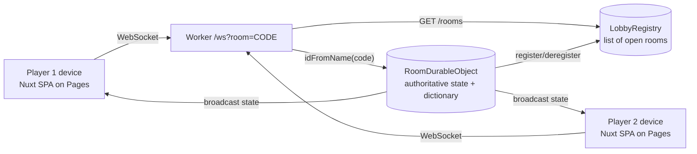

# WordMorph | Versus

A head-to-head word-transformation duel. Players alternate turns mutating a shared
word **one letter at a time** into a new valid English word. Break the chain — an
invalid word, more/fewer than one letter changed, or a repeat — and your rival wins.

Two ways to play:

- **Same device (hot seat):** pass-and-play on one screen.
- **Two devices (online):** create a room, share the code/link, or **browse the public
  list of open rooms** and join one in a click. You can **leave a room** anytime before
  the match starts to free the slot.

**Fast-paced rules:** each player has **15 seconds** per turn, and your move is
submitted **the instant you type a letter** — one keystroke locks it in, no take-backs.
Run out of time and you lose. In online mode the clock is enforced by the server
(the Durable Object), so neither side can stall or disagree.

Built with **Nuxt 3 (Vue 3, `ssr: false`)** for the frontend and a **Cloudflare Worker
with a Durable Object** for authoritative real-time multiplayer. Both halves run on the
Cloudflare **free tier**.

## Architecture



- The frontend is a static SPA. In online mode each device opens a WebSocket to the
  Worker at `/ws?room=CODE`.
- The Worker routes each room code to a single **`RoomDurableObject`** instance
  (`env.ROOM.idFromName(code)`) that holds the authoritative game state and the
  dictionary, validates every move, and broadcasts the resulting state to both players.
- A single **`LobbyRegistry`** Durable Object tracks rooms that are **waiting for a
  second player**. Each room registers itself when it enters the waiting state and
  deregisters when it fills, ends, empties, or the host leaves. `GET /rooms` returns this
  list for the lobby's "Open rooms" browser (fetched on load and on Refresh).
- Clients are thin renderers: they send intents (`join`, `start`, `move`, `rematch`,
  `resign`, `leave`) and render whatever `state` the server broadcasts. **The client
  never decides win/loss** — the server does.
- The DO uses the **WebSocket Hibernation API**, so it is evicted from memory between
  turns while sockets stay open. Combined with SQLite-backed storage, this keeps the
  game comfortably within the free tier.

Hot-seat mode reuses the original in-browser game logic and needs no backend.

## Project structure

```
word-morph-versus/
├─ app.vue                      # Screen router: mode select / lobbies / board
├─ nuxt.config.ts               # ssr:false, static preset, runtimeConfig.public.wsUrl
├─ tailwind.config.ts
├─ assets/css/main.css
├─ components/
│  ├─ ModeSelect.vue            # Same device vs Two devices (online)
│  ├─ GameLobby.vue             # Hot-seat lobby (names + length)
│  ├─ OnlineLobby.vue           # Create/join room, invite link, waiting room
│  ├─ GameBoard.vue             # Turn indicator, tiles, history (both modes)
│  ├─ TileInput.vue
│  ├─ WordChainHistory.vue
│  └─ GameOverDialog.vue
├─ composables/
│  ├─ useWordMorph.ts           # Hot-seat game logic (client-authoritative)
│  ├─ useOnlineGame.ts          # WebSocket client store (server-authoritative)
│  └─ useGameSession.ts         # Facade exposing ONE interface for both modes
├─ public/words-{4,5,6}.json    # Word lists (client copy; optional for online)
├─ test/                        # Vitest: online store, lobby, turn gating
└─ worker/                      # Cloudflare Worker (separate deploy)
   ├─ src/
   │  ├─ index.ts               # Router: /new, /rooms, /ws?room=CODE, CORS
   │  ├─ RoomDurableObject.ts    # Authoritative state + WS hibernation + alarm
   │  ├─ LobbyRegistry.ts       # Global registry of open (waiting) rooms
   │  ├─ gameLogic.mjs          # Shared pure rules (+ gameLogic.d.ts types)
   │  └─ words/words-{4,5,6}.json
   ├─ wrangler.toml             # SQLite DO migrations + ROOM & REGISTRY bindings
   └─ test/                     # node:test unit + WS integration driver
```

## Local development

You need **two processes**: the Worker and the Nuxt frontend.

```bash
# 1) Install (root + worker)
npm install
cd worker && npm install && cd ..

# 2) Terminal A — run the Worker (Durable Object) locally
cd worker
npx wrangler dev            # serves http://127.0.0.1:8787

# 3) Terminal B — run the frontend
npm run dev                 # serves http://localhost:3000
```

The frontend defaults `runtimeConfig.public.wsUrl` to `http://127.0.0.1:8787`, so online
mode talks to your local Worker out of the box. Open two browser windows (or your phone
on the same network) to play across "devices".

## Tests

```bash
# Frontend (Vitest): online store, lobby, turn gating
npm test

# Worker unit rules (node:test)
cd worker && npm test

# Worker WebSocket integration (boots `wrangler dev`, plays a full 2-client match)
cd worker && bash test/run-ws-it.sh
```

The integration driver verifies the full flow: both players join, server seeds the
start word, valid moves advance the chain and flip turns, out-of-turn moves are
rejected, an illegal move ends the game with the opponent winning (synced to both
clients), rematch/resign work, a third joiner is rejected, rooms are isolated, and a
dropped player can rejoin with the same code+name to resume.

## Deploy (Cloudflare free tier)

The app has **two independently deployed halves**: the **Worker** (backend: Durable
Objects + WebSockets) and the **static frontend** (Cloudflare Pages). Deploy the Worker
first so you have its URL to point the frontend at.

### One-time setup

```bash
npm install -g wrangler        # or just use `npx wrangler ...`
wrangler login                 # opens a browser to authorize your Cloudflare account
wrangler whoami                # confirm the account you're deploying to
```

> **First-time account gotcha:** if your Cloudflare account has never used Workers, the
> first `wrangler deploy` can fail with `You need a workers.dev subdomain` (code 10063).
> Fix it once: open the Cloudflare dashboard → **Workers & Pages**, and (if prompted)
> pick a subdomain. Then re-run the deploy — it goes straight through. Your Worker will
> live at `https://word-morph-worker.<your-subdomain>.workers.dev`.

### 1) Deploy the Worker + Durable Objects

```bash
cd worker
wrangler deploy
```

`wrangler.toml` declares **two SQLite-backed Durable Object migrations**
(`new_sqlite_classes = ["RoomDurableObject"]` and `["LobbyRegistry"]`). SQLite-backed
DOs are required on the free plan (key-value DOs are paid-only). The deploy output prints
your Worker URL — **copy it**, you need it for the frontend. Verify it's live:

```bash
curl https://word-morph-worker.<your-subdomain>.workers.dev/health
# -> {"ok":true,"service":"word-morph-worker"}
```

### 2) Deploy the frontend to Pages

Bake the Worker URL into the static build via `NUXT_PUBLIC_WS_URL`, then generate:

```bash
# from the repo root
NUXT_PUBLIC_WS_URL="https://word-morph-worker.<your-subdomain>.workers.dev" \
  npm run generate
```

Then publish `.output/public` with **either** approach:

**A) Direct upload (fastest).** The Pages project must exist first:

```bash
# one-time: create the project
npx wrangler pages project create word-morph-versus --production-branch=main

# each deploy
npx wrangler pages deploy .output/public --project-name=word-morph-versus --branch=main
```

The site goes live at `https://word-morph-versus.pages.dev` (plus a per-deploy preview
URL like `https://<hash>.word-morph-versus.pages.dev`).

**B) Git integration (auto-deploy on push).** In the Cloudflare dashboard → Pages →
connect your repo and set:
- **Build command:** `npm run generate`
- **Build output directory:** `.output/public`
- **Environment variable:** `NUXT_PUBLIC_WS_URL` = your Worker URL

That's it — static frontend on Pages, real-time backend on the Worker, both free.

### Redeploying later

```bash
# Backend (after changing anything in worker/ — new DO classes need a redeploy):
cd worker && wrangler deploy

# Frontend (always rebuild with the Worker URL so it isn't baked to localhost):
NUXT_PUBLIC_WS_URL="https://word-morph-worker.<your-subdomain>.workers.dev" \
  npm run generate
npx wrangler pages deploy .output/public --project-name=word-morph-versus --branch=main
```

> **Keep the two in sync:** the frontend's `NUXT_PUBLIC_WS_URL` is **baked in at build
> time** (it's a static SPA). If you move or rename the Worker, you must regenerate and
> redeploy the frontend. The repo's local default is `http://127.0.0.1:8787` for dev, so
> never ship a build made without the production `NUXT_PUBLIC_WS_URL` set.

## Free-tier notes

- Durable Objects (free): 100k requests/day, 13k GB-s/day compute, 5 GB SQLite storage.
- WebSocket Hibernation means an idle room (between turns) is **not** billed for compute
  duration; `ping/pong` keepalives are handled as auto-responses without waking the DO.
- Idle rooms self-expire after 30 minutes (a DO `alarm()` clears their storage), so
  abandoned games don't accumulate.

## How a game ends

Identical rules in both modes (the server enforces them online):

| Situation                                   | Loss reason          |
| ------------------------------------------- | -------------------- |
| Word not in the dictionary                  | `invalid-word`       |
| Changed zero or more than one letter        | `not-single-change`  |
| Repeated a word already in the chain        | `repeat`             |
| Player resigned                             | `resign`             |
| Ran out of time (15s per turn)              | `timeout`            |

Example chain: `FALL → HALL → HALT → HALF → CALF`. Changing `CALF → CARF` is a single
letter but not a word, so it loses with `invalid-word`.

## Regenerating word lists (optional)

`scripts/build-wordlists.mjs` rebuilds the word lists from the **ENABLE** word list
(`scripts/enable.txt`, ~173k words) and a common-word list (`scripts/common-words.txt`).
It emits two files per length into `public/`:

- `words-{4,5,6}.json` — the full validation set (every accepted move), and
- `starts-{4,5,6}.json` — a common-biased subset used only to seed the random start
  word, so matches open on familiar words.

Dead-ends are pruned so every word has at least one single-letter neighbor. After
regenerating, copy all of them into the Worker so server-side validation matches:

```bash
node scripts/build-wordlists.mjs
cp public/words-*.json public/starts-*.json worker/src/words/
```

## Roadmap / TODO

- **Rate limiting on the Worker API (not yet implemented).** The `/new`, `/rooms`, and
  `/ws` endpoints are currently unthrottled, so a client could spam them and burn
  free-tier request quota or hammer a room. Planned approach (free-tier-safe, no WAF /
  paid features required):
  - A small **per-IP limiter Durable Object** (token bucket keyed on
    `CF-Connecting-IP`) in front of the HTTP/WS entry points. Suggested defaults:
    `/new` ~10/min, `/rooms` ~30/min, `/ws` ~10 new connections/min per IP.
  - **Per-socket message throttling** inside `RoomDurableObject` (e.g. ~1 `move`/250ms,
    and caps on `join`/`rematch` spam) as cheap in-memory defense against scripted
    clients — no extra infrastructure since the room DO already exists.
  - Notes: fall back gracefully when `CF-Connecting-IP` is absent (e.g. local
    `wrangler dev`). This is basic app-level abuse protection, **not** DDoS mitigation —
    that remains Cloudflare's edge responsibility.
- Optional: convert the Worker-URL config / Pages deploy to Git integration so pushes
  auto-build and auto-deploy.
